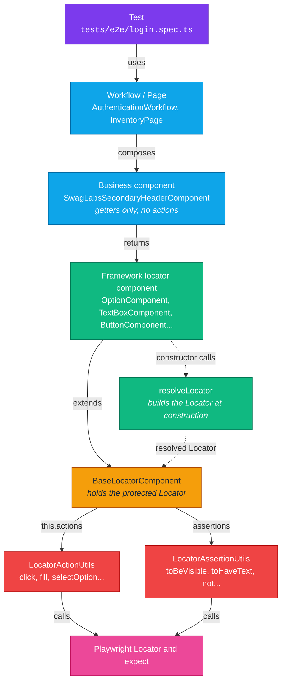

# Playwright Sauce Labs Demo

A Playwright + TypeScript framework for [SauceDemo](https://www.saucedemo.com),
built so tests read like human-language specs (a DSL) instead of selector code.

## Contents

- [Why this architecture](#why-this-architecture)
- [Project structure](#project-structure)
- [Responsibility boundaries](#responsibility-boundaries)
- [Framework components](#framework-components)
- [How locators are resolved](#how-locators-are-resolved)
- [How components get actions and assertions](#how-components-get-actions-and-assertions)
- [Assertions and actions](#assertions-and-actions)
- [Business layer](#business-layer)
- [Writing tests](#writing-tests)
- [Code quality](#code-quality)
- [Tooling and quality gates](#tooling-and-quality-gates)
- [Composing locators](#composing-locators)

## Why this architecture

SauceDemo is only the practice target. It is small on purpose, and a handful of
loose Playwright scripts would test it just fine. This repository is not that.
It is a framework designed for large, complex systems: many pages, shared
widgets, third-party components (maps, payment forms, rich editors), several
teams writing tests, and suites that live for years. The patterns below look
like overkill on a tiny app because they pay off at scale.

| Decision                                                        | Why it matters on a complex product                                                                                                                                  |
| --------------------------------------------------------------- | -------------------------------------------------------------------------------------------------------------------------------------------------------------------- |
| **Framework and business layers are separate**                  | The framework knows nothing about any application, so it can be reused across products and versioned on its own. Only the business layer changes per application.     |
| **Tests read as a DSL** (`secondaryHeader.priceLowToHigh.click()`) | Specs read like requirements. Product owners, manual testers and new engineers can review them, and intent stays visible instead of drowning in selectors.         |
| **Business components are getters only**                        | A selector lives in exactly one place. When the UI changes, one getter changes and hundreds of tests keep working. No state means no stale caches or order-dependent bugs. |
| **The `Locator` is `protected`**                                | Tests cannot bypass the framework with raw Playwright calls, so conventions cannot erode as the team and the suite grow.                                             |
| **One resolver builds every locator**                           | Scoping, filtering and positioning behave identically everywhere. Components compose into deep chains without anyone hand-writing brittle CSS or XPath paths.        |
| **Actions and assertions in two util classes**                  | Playwright is called in exactly two files. Cross-cutting behavior is added once and applies to every component: readiness waiters for flaky third-party widgets, fail-fast guards for server and application errors, logging, tracing steps, retries. |
| **Components inherit one base**                                 | Every element gets the same assertions and `click()` for free. A new component type is a few lines, and consistency is structural instead of a code-review chore.   |
| **Lint rules as guardrails**                                    | Missing `await`, `waitForTimeout`, `networkidle` and forced clicks are rejected automatically, which keeps a large suite stable and fast.                            |
| **Framework tests with one `describe` per component**           | The framework is verified on its own, so a regression in shared code is caught at the source and not as hundreds of confusing e2e failures.                          |

Design principles at work:

- **Single responsibility:** pages describe where, components describe what,
  utils describe how, tests describe the expected outcome.
- **Open for extension, closed for modification:** new behavior goes into the
  action and assertion utils or a new component, never into every test.
- **Composition over copy-paste:** complex screens are built by nesting small,
  proven components.
- **Fail early with a clear cause:** guards and waiters stop a test at the
  moment an error appears, with a message that names it.

When adding a new application, area or widget, keep the same shape: resolve
locators through components, expose them through getters, and keep every
Playwright call inside the utils. The size of the application being tested
should never change that.

## Project structure

```text
playwright.config.ts           # Playwright runner and browser configuration
tests/e2e/                     # Scenarios and assertions for business outcomes
tests/framework/               # Tests for reusable framework behavior
src/
  framework/                   # Reusable, application-agnostic test infrastructure
    bases/                     # BaseLocatorComponent and BaseWebPage
    components/                # Button, TextBox, Text, Option, List, Table, ...
    constants/                 # LocatorPosition
    resolvers/                 # resolveLocator and toLocator
    types/                     # Locator option and source types
    utils/                     # LocatorActionUtils and LocatorAssertionUtils
  business/                    # Expandable SauceDemo domain implementation
    components/                # Getters that return framework components
    pages/                     # Page objects composed from components
    resources/                 # Test data and constants (users, sort options)
    workflows/                 # User goals composed from business page objects
```

## Responsibility boundaries

- **Framework (`src/framework`):** Shared bases, locator components, constants,
  types, and resolvers belong here. Keep this layer application-agnostic; it
  must not know about SauceDemo pages, selectors, or user workflows.
- **Business (`src/business`):** SauceDemo-specific components, pages, user
  workflows, constants, and resources belong here. Components own selectors
  and only return framework components through getters; pages compose
  components; workflows express user goals.
- **Tests (`tests`):** Scenarios compose business workflows with test data and
  assert observable outcomes using the framework's Playwright test entry point.
- **Root tooling:** `playwright.config.ts`, `tsconfig.json`, and `package.json`
  configure the test runner, TypeScript, and project commands.

Run the suite with `npm test`.

## Framework components

Every component extends `BaseLocatorComponent`, which wraps one Playwright
`Locator` (kept `protected`, so tests never touch it). A component takes a
parent (a `Page` or another component), a name, and optional query and
resolver options.

| Component                      | Locates by                  | Extra members                                  |
| ------------------------------ | --------------------------- | ---------------------------------------------- |
| `ButtonComponent`              | role `button`, name         | `isEnabled`, `isDisabled`                      |
| `TextBoxComponent`             | placeholder                 | `fill`, `clear`, `getValue`                    |
| `TextComponent`                | text                        | `getText`                                      |
| `TitleComponent`               | `title` attribute           | -                                              |
| `ComboBoxComponent`            | role `combobox`             | `selectOption`                                 |
| `OptionComponent`              | role `option`, name         | `click()` selects the option by label          |
| `DataTestComponent`            | test id (`data-test`)       | -                                              |
| `ListComponent`                | role `list`                 | `items()`, `itemContaining(text)`              |
| `TableComponent`               | role `table`                | `rowContaining(text)`, `cellNamed(name)`       |
| `ListItemComponent`, `RowComponent`, `CellComponent` | role `listitem`, `row`, `cell` | - |

Components nest by passing one as the parent of another, which produces a
scoped chain such as
`getByTestId('secondary-header').getByTestId('active-option').getByText('Name (A to Z)')`:

```ts
const header = new DataTestComponent(page, 'secondary-header')
const active = new DataTestComponent(header, 'active-option')
const label = new TextComponent(active, 'Name (A to Z)')
```

A native `<option>` is never visible, so `OptionComponent.click()` selects it by
label on its parent `<select>` instead of clicking.

## How locators are resolved

A component never builds a Playwright locator by hand. Its constructor passes a
parent, an initial query and the options to `resolveLocator`, and hands the
result to `BaseLocatorComponent`:

```ts
export class DataTestComponent extends BaseLocatorComponent {
  constructor(parent: LocatorParent, value: string, options?: LocatorOptions) {
    super(resolveLocator(parent, (root) => root.getByTestId(value), options))
  }
}
```

`resolveLocator(parent, initialLocator, options, ...resolvers)` works in order:

1. **Unwrap the parent.** A `Page` or `Locator` is used as is. A component is
   unwrapped with `toLocator`, the single path to a component's locator (it
   calls `BaseLocatorComponent.locatorOf`). This is what lets any component
   be a parent, so chains are scoped.
2. **Run the initial query** on that root, for example `root.getByTestId(value)`.
3. **Apply the options** in a fixed order: `within`, `filter`
   (`has`/`hasNot`/`hasText`), `childLocator`, `and`, then `position`
   (`First`, `Last` or `Nth`). Every option that takes a locator also accepts a
   component.
4. **Run extra resolvers** left to right, each receiving the previous result.

Nesting components therefore produces one chained Playwright locator:

```ts
const header = new DataTestComponent(page, 'secondary-header')
const active = new DataTestComponent(header, 'active-option')
const label = new TextComponent(active, 'Name (A to Z)')
// page.getByTestId('secondary-header').getByTestId('active-option').getByText('Name (A to Z)')
```

`childLocator` is different: it filters the component to those containing the
given locator (`filter({ has })`), which is absolute and not a nested scope. To
scope into a child, make the component the parent of another one, as above.

The `locator` field is `protected`, so tests and business code can't reach it.
Only the resolver unwraps a component, through `locatorOf`.

## How components get actions and assertions

### From test to Playwright



Read it top to bottom: a test talks to pages and workflows, which compose
business components. Those only return framework components, and every
framework component is a `BaseLocatorComponent`. The base class hands its
locator to the two util classes, the only code that calls Playwright. The
dotted arrows happen once, when the component is built.

### What happens on one call

```mermaid
%%{init: {"theme": "base", "themeVariables": {
  "actorBkg": "#7c3aed", "actorTextColor": "#ffffff", "actorBorder": "#5b21b6",
  "signalColor": "#0ea5e9", "signalTextColor": "#0369a1",
  "noteBkgColor": "#fde68a", "noteTextColor": "#1f2937", "noteBorderColor": "#f59e0b",
  "activationBkgColor": "#10b981", "sequenceNumberColor": "#ffffff"
}}}%%
sequenceDiagram
    participant Test
    participant Page as InventoryPage
    participant Biz as SecondaryHeader (business)
    participant Opt as OptionComponent
    participant Base as BaseLocatorComponent
    participant Act as LocatorActionUtils
    participant PW as Playwright Locator

    Test->>Page: secondaryHeader
    Page-->>Test: SwagLabsSecondaryHeaderComponent
    Test->>Biz: priceLowToHigh (getter)
    Biz->>Opt: new OptionComponent(productSort, label)
    Note over Opt: resolveLocator chains the parents into one Locator
    Biz-->>Test: OptionComponent
    Test->>Opt: click()
    Opt->>Act: selectOption({ label }) on the parent select
    Act->>PW: locator.selectOption(...)
    Test->>Base: toBeVisible() (any component)
    Base->>PW: expect(locator).toBeVisible()
```

### Where each method comes from

```text
            BaseLocatorComponent
   click()  not  toBeVisible()  toHaveText()  toHaveCount() ...
                    ^
   ┌─────────┬──────┴──────┬───────────┬────────────┐
 Button    TextBox       Text       ComboBox      Option
 isEnabled fill/clear    getText    selectOption  click() -> select by label
 isDisabled getValue
```

Everything on the top row is inherited by every component. Each subclass adds
only the actions its element needs, through the protected `actions`:
`TextBoxComponent.fill()` calls `this.actions.fill(value)`.

### How the pieces are wired

1. A component's constructor passes the resolved `Locator` to
   `BaseLocatorComponent`.
2. `BaseLocatorComponent` creates one `LocatorActionUtils` and one
   `LocatorAssertionUtils` around that same locator.
3. Its public methods delegate to them: `click()` calls `actions.click()`,
   and `toBeVisible()` calls the assertion util. `not` returns a negated
   assertion util, so `component.not.toBeVisible()` negates the check.
4. Subclasses add their own actions through the protected `actions`.

Every component therefore inherits the same assertions and `click()`, and
Playwright is called in exactly two files: `LocatorActionUtils` and
`LocatorAssertionUtils`. Cross-cutting behavior (guards, waiters, logging) can
be added once in those files.

A business getter ties it together, and the test only sees the DSL:

```ts
// business: returns a component, no logic
get priceLowToHigh(): OptionComponent {
  return new OptionComponent(this.productSort, ProductSortOptions.PriceLowToHigh, { exact: true })
}

// test: the inherited click() runs LocatorActionUtils on the resolved locator
await inventoryPage.secondaryHeader.priceLowToHigh.click()
```

## Assertions and actions

Assertions and actions live only in the framework and are reached through
`BaseLocatorComponent`. Components never expose their own action methods.

- **Assertions** (`src/framework/utils/locator-assertion.utils.ts`):
  `toBeVisible`, `toBeHidden`, `toBeEnabled`, `toBeDisabled`, `toBeFocused`,
  `toHaveCount`, `toHaveText`, `toContainText`, `toHaveValue`, `toHaveClass`,
  `toHaveAttribute`. Negate any of them with `not`. Each accepts `{ timeout }`.
- **Actions** (`src/framework/utils/locator-action.utils.ts`): `click`, `fill`,
  `clear`, `selectOption`, `getText`, `getValue`, `isEnabled`, `isDisabled`.
  `LocatorActionUtils` is the only place that calls Playwright action methods,
  so guards and waiters can later be added there once for every component.

```ts
await loginForm.username.fill('standard_user')
await loginForm.submit.click()
await inventoryPage.headerContainer.logoText.toBeVisible()
await inventoryPage.headerContainer.shoppingCartEmpty.not.toBeVisible()
```

Always `await` these calls; the `no-floating-promises` lint rule enforces it.

## Business layer

Business components extend `BaseComponent`, receive a root (`Page` or
component), and expose getters that return framework components. They hold no
action methods, caches, or thrown errors. Getter names use the organic
language of the application so tests read as a spec:

```ts
export class SwagLabsSecondaryHeaderComponent extends BaseComponent {
  private get container(): DataTestComponent {
    return new DataTestComponent(this.root, 'secondary-header')
  }

  private get productSort(): DataTestComponent {
    return new DataTestComponent(this.container, 'product-sort-container')
  }

  get priceLowToHigh(): OptionComponent {
    return new OptionComponent(this.productSort, ProductSortOptions.PriceLowToHigh, { exact: true })
  }

  activeOption(text: ProductSortOption): TextComponent {
    return new TextComponent(new DataTestComponent(this.container, 'active-option'), text)
  }
}
```

- **Pages** (`src/business/pages`) extend `BaseWebPage` and expose components
  as getters, for example `inventoryPage.secondaryHeader`.
- **Resources** (`src/business/resources`) hold constants and data, such as
  `ProductSortOptions` (visible labels, not option values) and `standardUser`.
- **Workflows** (`src/business/workflows`) express user goals, such as
  `AuthenticationWorkflow.signIn(username, password)`.
- A form may expose a combined action (for example `signIn`) because it
  combines several components; single selections stay a plain `click()`.

## Writing tests

Tests compose workflows and pages, then assert through components:

```ts
test('allows a standard user to sign in', async ({ page }) => {
  const loginPage = new LoginPage(page)
  const authentication = new AuthenticationWorkflow(loginPage)
  const inventoryPage = new InventoryPage(page)

  await authentication.signIn(standardUser.username, standardUser.password)

  await inventoryPage.expectCurrentPage()
  await inventoryPage.headerContainer.logoText.toBeVisible()
  await inventoryPage.secondaryHeader.activeOption(ProductSortOptions.NameAtoZ).toBeVisible()
  await inventoryPage.secondaryHeader.priceLowToHigh.click()
  await inventoryPage.secondaryHeader.activeOption(ProductSortOptions.PriceLowToHigh).toBeVisible()
})
```

- `tests/e2e/` holds business scenarios against the real site.
- `tests/framework/components.spec.ts` verifies the framework with one
  `test.describe` per component, using our components instead of raw
  Playwright.

Use `expect.poll` for conditions Playwright does not wait for. Do not use
`waitForTimeout`; the `playwright/no-wait-for-timeout` rule rejects it.

## Code quality

Code quality is a requirement, not a nice-to-have. A framework that many
people extend for years only stays reliable if the rules are enforced by
tools instead of memory. Every rule below runs locally, in the editor and
before each commit.

### Rules that are enforced

| Area            | Rule                                                                                                          | Enforced by                           |
| --------------- | ------------------------------------------------------------------------------------------------------------- | ------------------------------------- |
| Types           | `strict` TypeScript; the whole project must compile with no errors                                            | `npm run typecheck` (`tsconfig.json`) |
| Formatting      | No semicolons, single quotes, 2-space indent, 80-column width, trailing commas                                | Prettier (`.prettierrc.json`)         |
| Style           | Google style guide, relaxed for TypeScript (JSDoc not required), max line length 120                          | ESLint (`google`, `prettier` configs) |
| Dead code       | Unused variables and imports are errors                                                                       | `@typescript-eslint/no-unused-vars`   |
| Async safety    | Every promise must be awaited; no `await` on non-promises; no promises passed where a plain value is expected | `no-floating-promises`, `await-thenable`, `no-misused-promises` |
| Stable waits    | No `waitForTimeout`; use web-first conditions and `expect.poll`                                               | `playwright/no-wait-for-timeout`      |
| Stable loading  | No `networkidle`                                                                                              | `playwright/no-networkidle`           |
| Real user flows | No `force` option on actions                                                                                  | `playwright/no-force-option`          |
| Clean commits   | No `page.pause()` left behind                                                                                 | `playwright/no-page-pause`            |
| Deterministic   | No conditionals inside tests                                                                                  | `playwright/no-conditional-in-test`   |
| Retrying checks | Prefer web-first assertions over manual value checks                                                          | `playwright/prefer-web-first-assertions` |
| Gate            | Lint and format checks must pass before a commit is created                                                  | Husky `pre-commit`                    |

Architecture rules are part of quality too and are reviewed like any other:

- Tests never use raw Playwright locators or `expect`; they use components.
- Business components contain only getters, with organic names, no caches
  and no thrown errors.
- Only `LocatorActionUtils` and `LocatorAssertionUtils` call Playwright.
- Selectors live in one business getter, and test data lives in `resources`.
- Every framework component has framework tests, one `describe` each.

Run all gates locally with:

```bash
npm run typecheck
npm run lint
npm run format:check
npm test
```

### Recommended VS Code extensions

The list is in `.vscode/extensions.json`, so VS Code offers to install it when
the repository is opened.

| Extension                                                                                          | Why it helps                                                                       |
| -------------------------------------------------------------------------------------------------- | ---------------------------------------------------------------------------------- |
| [Playwright Test](https://marketplace.visualstudio.com/items?itemName=ms-playwright.playwright)    | Run and debug tests from the editor, pick locators, and record flows.              |
| [ESLint](https://marketplace.visualstudio.com/items?itemName=dbaeumer.vscode-eslint)               | Shows the same rule violations as `npm run lint` while you type.                   |
| [Prettier](https://marketplace.visualstudio.com/items?itemName=esbenp.prettier-vscode)             | Formats on save with the project's `.prettierrc.json`.                             |
| [Error Lens](https://marketplace.visualstudio.com/items?itemName=usernamehw.errorlens)             | Displays errors and warnings inline, so a missing `await` is hard to miss.         |
| [SonarQube for IDE](https://marketplace.visualstudio.com/items?itemName=SonarSource.sonarlint-vscode) | Finds bugs, code smells and security issues as you write.                       |
| [Code Spell Checker](https://marketplace.visualstudio.com/items?itemName=streetsidesoftware.code-spell-checker) | Catches typos in names and test titles, which matter in a DSL.    |
| [GitLens](https://marketplace.visualstudio.com/items?itemName=eamodio.gitlens)                     | Shows who changed a line and why, which helps reviews of shared framework code.    |
| [Markdown Preview Mermaid Support](https://marketplace.visualstudio.com/items?itemName=bierner.markdown-mermaid) | Renders the diagrams in this README.                                 |

Suggested workspace settings: enable format on save with Prettier and run
ESLint fixes on save.

## Tooling and quality gates

Prettier formats TypeScript and ESLint configuration files without semicolons.
ESLint also runs `eslint-plugin-playwright` (no `waitForTimeout`, no
`networkidle`, no `force` option, no conditionals in tests) and type-aware
promise rules that fail on any missing `await`.
Husky runs ESLint and checks formatting before each commit. Run `npm run lint`,
`npm run format`, and `npm run typecheck` locally. The Playwright workflow runs all tests in
`tests/e2e/` only when that test directory changes, or when started manually.
Each e2e run uploads the report as an artifact. Push and manual runs also
publish the HTML report to GitHub Pages and include its URL in the workflow
summary. The workflow attempts to enable Pages when needed; if repository
settings prevent workflow-managed enablement, an administrator must enable it.
Pull-request runs upload the artifact but do not deploy to Pages.

## Composing locators

Use `resolveLocator` with locator callbacks to compose Playwright locators.
Framework components use the same resolver internally for their root and
nested locators:

```ts
const inventoryTable = page.getByRole("table", { name: "Inventory" });

const backpackText = resolveLocator(
  page,
  (root) => root.getByText("Backpack", { exact: true }),
  { within: inventoryTable },
);

const backpackStockStatus = resolveLocator(
  inventoryTable,
  (table) => table.getByRole("row"),
  { filter: { has: page.getByText("Backpack") } },
  (row) => row.getByText("In stock", { exact: true }),
);

const exactProduct = resolveLocator(
  page,
  (root) => root.getByText("Product", { exact: true }),
);

const secondChooseButton = resolveLocator(
  page,
  (root) => root.getByRole("button", { name: "Choose" }),
  { position: { type: LocatorPosition.Nth, index: 1 } },
);

const productsEditButton = new TextComponent(page, "Products", {
  exact: true,
  childLocator: new ButtonComponent(page, "Edit"),
});
```

Components expose their Playwright locator only to the framework. Anywhere a
locator is accepted (`within`, `and`, `childLocator`, `filter.has`/`hasNot`, or
a component's parent) you pass another component instead. Assertions and
actions live on `BaseLocatorComponent` (`toBeVisible`, `toHaveText`,
`toHaveCount`, `toHaveValue`, `toHaveAttribute`, `toHaveClass`, `click`, ...);
negate any assertion with `not`:

```ts
await secondaryHeader.nameAtoZ.click();
await cart.not.toBeVisible();
```

Business components only return components and hold no actions or caches.

The resolver options support `within`, Playwright's `filter` options, and a
`position` chosen from the `LocatorPosition` constants (`First`, `Last`, or
`Nth` with an index).
`exact` remains a native option on the initial Playwright query. For example,
`TextComponent` combines the native text options with the resolver options,
including `childLocator`, which filters to text matches containing that locator:

Locator option types are defined in `src/framework/types/locator.types.ts`;
`LocatorPosition` is defined in `src/framework/constants/locator-position.constants.ts`.
Components use the shared generic
`LocatorOptions<TQueryOptions>` to combine their Playwright query options with
the common resolver options.

```ts
new TextComponent(page, "Products", {
  exact: true,
  filter: { hasText: "Products" },
  position: { type: LocatorPosition.First },
});
```

`filter({ has })` selects a container based on related text before locating a
specific descendant. Use `hasText` instead when matching directly on a text
value.

Playwright's `Locator.within()` accepts a parent locator and returns a scoped
locator; it is not an async callback block. Keep a scoped locator and use it for
each interaction:

```ts
const pricingCard = page
  .getByTestId("premium-plan-card")
  .within(page.getByTestId("pricing-cards"));

await pricingCard.getByPlaceholder("Enter promo code").fill("SAVE20");
await pricingCard.getByRole("button", { name: "Apply" }).click();
await pricingCard.getByRole("checkbox", { name: "Accept Terms" }).check();
```

Other supported patterns include chaining a filtered list item to its button,
finding a labeled form field within a form, and locating a button within a
text-matched table row. The framework tests cover each case.
